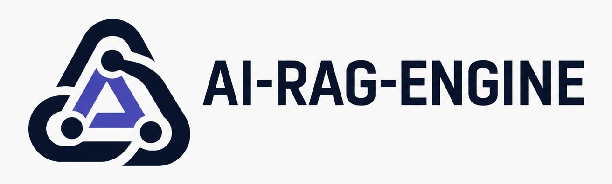
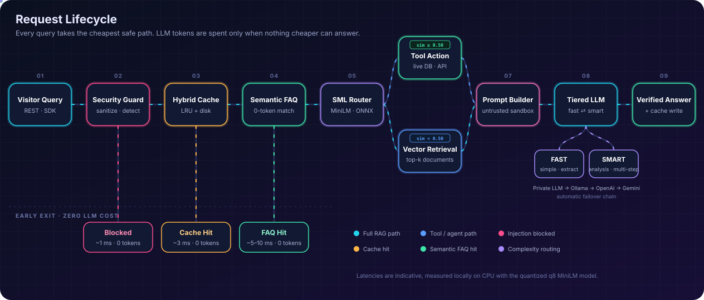
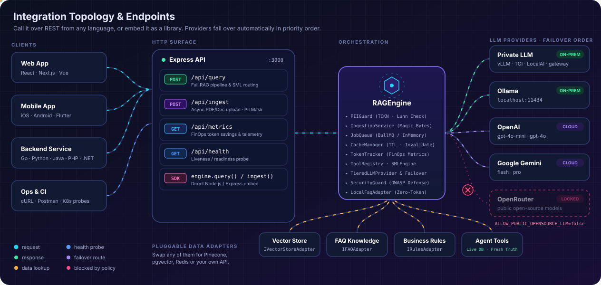
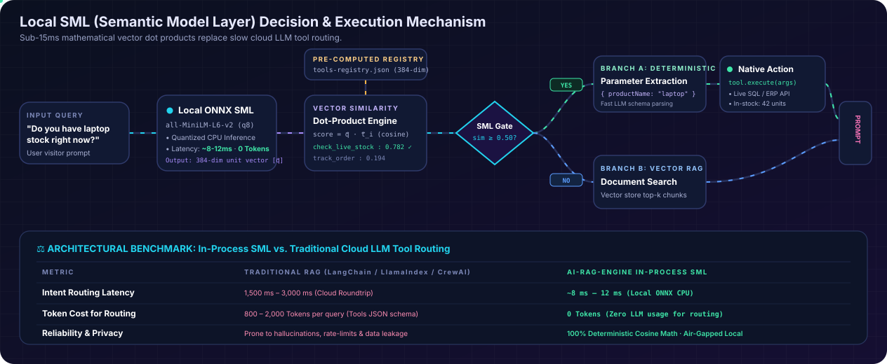

<div align="center">



**High-throughput TypeScript RAG framework featuring local semantic routing, zero-cost FAQ short circuits, multi-tenant isolation, hybrid vector search, and durable document ingestion.**

[](https://www.npmjs.com/package/@denizsvnc/ai-rag-engine)
[](https://github.com/Denizsvnc/ai-rag-engine/actions)
[](https://nodejs.org/)
[](https://bun.sh)
[](https://www.typescriptlang.org/)
[](LICENSE)

</div>

---

### Documentation Languages

**[English](README.md)** • **[Türkçe](README_tr.md)** • **[Deutsch](README_de.md)**

---

## Why AI-RAG-ENGINE?

Conventional RAG pipelines dispatch every incoming user query directly to an external LLM, resulting in compounding API costs, latency bottlenecks on repetitive questions, and risks of sensitive data exposure.

**AI-RAG-ENGINE** implements a cost-aware, multi-tiered request lifecycle that resolves queries at the earliest safe layer:

- **Local Semantic Short-Circuits:** Frequent inquiries and semantic cache hits are resolved locally with sub-millisecond in-memory cache lookup latency with zero token expenditure.
- **Hybrid Vector Retrieval:** Combines dense cosine similarity with sparse full-text search (`tsvector` / `websearch_to_tsquery` in PostgreSQL `pgvector`, or Okapi BM25 in memory) via Reciprocal Rank Fusion (RRF).
- **Defense-in-Depth Security:** Algorithmic PII masking (Turkish TCKN modulo-10 checks, Credit Card Luhn validation, IBAN, email, phone), prompt injection heuristic shields, and cryptographically signed HMAC confirmation tickets for state-mutating tools.
- **Strict Multi-Tenancy:** Parameterized tenant scoping across vector search, semantic caching, audit logging, and document ingestion.
- **Extensible Adapter Ecosystem:** Native support for Gemini, OpenAI, Ollama, OpenRouter, custom endpoints, Redis, and memory vector stores.

---

## Architecture & Request Lifecycle

```
User Query
    │
    ▼
[ 1. Security & PII Gate ] ── (Prompt Injection Check / PII Redaction)
    │
    ▼
[ 2. Semantic Cache Tier ] ── (Tenant-Scoped Cache Hit? ──> Return In-Memory, 0 Tokens)
    │
    ▼
[ 3. Local Semantic FAQ  ] ── (Local ONNX High-Confidence Match? ──> Return, 0 Tokens)
    │
    ▼
[ 4. SML Router & Tools  ] ── (Intent Classification / Read-Only Tool Execution)
    │
    ▼
[ 5. Hybrid Retrieval   ] ── (pgvector Dense Similarity + tsvector / BM25 Fusion)
    │
    ▼
[ 6. LLM Synthesis      ] ── (Context-Bounded Generation: Gemini, OpenAI, Ollama)
```

<div align="center">
  
</div>

1. **Security & PII Gate:** Evaluates raw inputs against injection heuristic patterns and masks sensitive PII before vector search or LLM dispatch.
2. **Semantic Cache Tier:** Inspects multi-tenant scoped cache keys; returns cached responses with sub-millisecond in-memory lookup latency without token cost.
3. **Local Semantic FAQ Tier:** Computes similarity via in-process ONNX embeddings (`all-MiniLM-L6-v2`); serves matched questions without calling an external model.
4. **SML Router & Tool Governance:** Small Model Engine classifies intents, enforces role-based tool execution, and requires HMAC confirmation tickets for mutations.
5. **Hybrid Retrieval:** Fuses dense vector embeddings with sparse keyword rankings (PostgreSQL `tsvector`/`tsquery` or in-memory BM25) using Reciprocal Rank Fusion ($k=60$).
6. **Context-Bounded Synthesis:** Formulates prompt contexts and streams answers through configured LLM providers with automated error failover and token accounting.

### Integration Topology & Endpoints

AI-RAG-ENGINE can be consumed either as an in-process TypeScript SDK or deployed as a containerized REST service with built-in JWT authentication, role-based access control, and automated LLM failover chains:

<div align="center">
  
</div>

---

## Installation

```bash
# npm
npm install @denizsvnc/ai-rag-engine

# bun
bun add @denizsvnc/ai-rag-engine

# pnpm
pnpm add @denizsvnc/ai-rag-engine
```

### Runtime Support

- **Node.js:** Supported on Node.js `22.14+`, `24.x`, and `26.x` (Pure ESM, `"type": "module"` required in `package.json`).
- **Bun:** Verified on Bun `v1.4.4+` via dedicated test suites (`bun test test/bun/bun-compat.test.ts`).
- **TypeScript:** Compatible with TypeScript `5.8+` with `NodeNext` or `Bundler` module resolution. Runtime applications do not require TypeScript or build tools.

---

## Quick Start

### 1. Minimal Deterministic Setup

This minimal example requires zero credentials, external databases, or model downloads. It uses deterministic test doubles to demonstrate the core SDK contract:

```js
import { RAGEngine } from '@denizsvnc/ai-rag-engine';

const engine = new RAGEngine({
  smlConfig: { enabled: false }, // Disables ONNX model download for fast local testing
  cache: { enabled: false },
  inputs: {
    vectorStore: {
      async search(_query, _topK, filter) {
        if (filter?.tenantId !== 'demo') return [];
        return [{ id: 'returns', content: 'Returns are accepted within 14 days.' }];
      }
    }
  },
  llmProvider: {
    async generate({ systemPrompt }) {
      return { content: systemPrompt.includes('14 days') ? 'Returns: 14 days.' : 'Unknown.' };
    }
  }
});

await engine.init();

const response = await engine.query('What is the return window?', {
  tenantId: 'demo',
  userId: 'demo-user',
  roles: ['viewer']
});

console.log(response.answer); // Returns: 14 days.
```

### 2. Production Multi-Tenant Setup (Gemini, pgvector & Redis)

For production deployments utilizing external LLMs, distributed caching, and vector persistence:

```typescript
import {
  RAGEngine,
  GeminiAdapter,
  PostgresVectorAdapter,
  RedisCacheAdapter,
  LocalFaqAdapter
} from '@denizsvnc/ai-rag-engine';

const engine = new RAGEngine({
  // 1. LLM Provider (Gemini 2.0 Flash, OpenAI, Ollama, OpenRouter, or Custom)
  llmProvider: new GeminiAdapter({
    apiKey: process.env.GEMINI_API_KEY!,
    model: 'gemini-2.0-flash',
    temperature: 0.2
  }),

  // 2. Knowledge Stores & Semantic FAQ Matching
  inputs: {
    vectorStore: new PostgresVectorAdapter({
      connectionString: process.env.DATABASE_URL!,
      tableName: 'enterprise_embeddings'
    }),
    faq: new LocalFaqAdapter({
      filePath: './knowledge/faq.json',
      defaultMatchThreshold: 0.85
    })
  },

  // 3. Distributed Redis Caching & Privacy Guardrails
  cache: {
    enabled: true,
    adapter: new RedisCacheAdapter({
      url: process.env.REDIS_URL!,
      defaultTtlMs: 3_600_000 // 1 hour
    })
  },
  security: {
    enabled: true,
    blockHighRiskInjections: true,
    pii: {
      enabled: true,
      maskTCKN: true,
      maskCreditCards: true,
      maskEmails: true,
      maskIBAN: true
    }
  }
});

await engine.init();

// Query executed with tenant boundaries and role-based access
const result = await engine.query('Summarize our customer refund policy', {
  tenantId: 'tenant-acme',
  userId: 'usr_8472',
  roles: ['customer_support']
});

console.log(result.answer);
console.log('Sources:', result.sources);
console.log('Latency:', result.latencyMs, 'ms');
```

---

## Core Capabilities

| Capability | Module / Implementation | Engineering Value |
| :--- | :--- | :--- |
| **Local SML Engine** | `SMLEngine` (`@huggingface/transformers`) | In-process ONNX embeddings with serialized initialization locks and lock-free parallel inference. |
| **Hybrid Search** | `HybridRetriever` & `BM25Index` | Fuses dense cosine vector similarity with sparse BM25 scores via Reciprocal Rank Fusion ($k=60$). |
| **Multi-Tenancy** | `PostgresVectorAdapter` & `CacheManager` | Enforces parameterized tenant scoping on all SQL queries, cache namespaces, and audit records. |
| **Privacy & PII** | `PIIGuard` | High-speed algorithmic masking for Turkish TCKN (checksum), Credit Cards (Luhn), IBAN, email, and phone. |
| **Tool Governance** | `ToolRegistry` & `ConfirmationService` | Zod schema validation, RBAC checks, and cryptographic HMAC confirmation tickets for state-mutating actions. |
| **Durable Ingestion** | `DocumentIngestionService` | Background queue (BullMQ/Memory) with magic-byte checks, streaming UTF-8 preservation, and native `zlib` PDF decompression. |
| **FinOps Metrics** | `TokenTracker` & `PrometheusExporter` | Real-time token usage, latency histograms, cost savings accounting, and Prometheus scraping (`/metrics`). |

### Local SML (Semantic Model Layer) Decision Mechanism

Sub-15ms mathematical vector dot products replace expensive cloud LLM calls for intent routing, FAQ matching, and safe read-only tool selection:

<div align="center">
  
</div>

### Secure Document Ingestion & PII Protection Pipeline

Asynchronous background worker queues validate magic bytes, redact sensitive personal data, preserve multi-byte UTF-8 character boundaries across streams, and index vectors with revision tracking:

<div align="center">
  
</div>

---

## Production & Operational Boundaries

To ensure reliable operations, the following boundaries and architectural trade-offs should be noted:

- **Security Heuristics:** Prompt injection detection and PII masking operate as heuristic defense-in-depth layers. They do not constitute a mathematical guarantee against all novel, multi-turn, or adversarial jailbreak vectors.
- **PDF Ingestion:** The built-in PDF extractor uses native `node:zlib` to synchronously decompress vector PDF `/Filter /FlateDecode` streams. Scanned raster documents requiring optical character recognition (OCR) are not supported.
- **Model Storage:** The SDK depends on `@huggingface/transformers`. The initial load of an SML model downloads weights from the Hugging Face hub unless pre-cached or configured with `localFilesOnly: true`.
- **Resource Ownership:** The SDK does not manage the lifecycle of user-injected database connection pools or Redis clients. The host application is responsible for draining pools on shutdown (`vectorStore.close()`, `redis.quit()`).
- **PostgreSQL Full-Text:** PostgreSQL hybrid search uses native `tsvector` and `tsquery` full-text search fused with dense vectors, rather than an external Lucene/BM25 cluster.

---

## Compatibility Matrix

| Technology | Supported Version | Verification Status | Notes |
| :--- | :--- | :--- | :--- |
| **Node.js** | `22.14+`, `24.x`, `26.x` | **Supported & Verified** | Verified across 191 automated test cases. Pure ESM. |
| **Bun** | `1.4.4+` | **Supported & Verified** | Verified via dedicated test suite (`test/bun/bun-compat.test.ts`). |
| **TypeScript** | `5.8+` | **Supported & Verified** | Strict declaration emit; requires `NodeNext` or `Bundler`. |
| **PostgreSQL** | `14+` with `pgvector` | **Supported & Verified** | Cosine similarity (`<=>`), L2 (`<->`), and inner product (`<#>`). |
| **Redis** | `6.2+`, `7.x` | **Supported & Verified** | Shared cache authority with standalone and cluster support. |

---

## Verified Performance Benchmarks

Measured on Apple Silicon (M-series, macOS), Node.js `v26.13.0`, across 107,000 total iterations (`npm run benchmark`):

| Component / Target | Iterations | Measured Throughput | Avg Latency | p95 Latency |
| :--- | :--- | :--- | :--- | :--- |
| **`TokenTracker` FinOps Recording** | 20,000 | **3,269,933 ops/sec** | 0.28 µs | 0.62 µs |
| **`CacheManager.get` (In-Memory Hot Path, Async)** | 10,000 | **2,688,322 ops/sec** | 0.32 µs | 0.71 µs |
| **`Dot Product` (384-dim Float32)** | 50,000 | **2,182,806 ops/sec** | 0.43 µs | 0.62 µs |
| **`RedisCacheAdapter.get` (In-Memory Fallback LRU, Async)** | 10,000 | **1,471,408 ops/sec** | 0.64 µs | 1.08 µs |
| **`Document Chunking & Magic Bytes Gate`** | 5,000 | **1,150,406 ops/sec** | 0.85 µs | 1.50 µs |
| **`PIIGuard.sanitize` (TCKN+Luhn+IBAN)** | 10,000 | **234,821 ops/sec** | 4.19 µs | 5.00 µs |
| **`BM25Index.search` (500-Doc Corpus)** | 2,000 | **21,441 ops/sec** | 46.61 µs | 56.29 µs |

> [!NOTE]
> **Benchmark Methodology & Scope:** Micro-benchmarks measure in-process CPU and in-memory execution paths under Node.js `v26.13.0` (heap allocation delta: ~10.14 MB across 107K iterations). Redis throughput reflects the local in-memory fallback LRU; remote network roundtrips and external LLM I/O will vary depending on network infrastructure.

*For complete benchmark methodologies and memory allocation profiles, refer to [`docs/audits/PERFORMANCE_BENCHMARK.md`](docs/audits/PERFORMANCE_BENCHMARK.md).*

---

## Repository Verification & Testing

Contributors and evaluating engineers can execute the complete automated verification matrix:

```bash
# 1. Typecheck & Build Declarations
npm run typecheck
npm run build

# 2. Automated Test Suite (Node.js)
npm test

# 3. Bun Compatibility Test Suite
npm run test:bun

# 4. Security Regression Tests
npm run test:security

# 5. Packaged Consumer & Distribution Verification
npm run test:package

# 6. High-Throughput Smoke Benchmark
npm run benchmark

# 7. Dependency Security Gate
npm audit --audit-level=high
```

---

## Documentation & Audits

- **[Usage & Configuration Guide](docs/USAGE.md)** — In-depth guide covering providers, vector stores, and BullMQ worker setup.
- **[Comprehensive Architectural Audit](docs/audits/ARCHITECTURE_AUDIT.md)** — Invariants, trust boundaries, and component lifecycles.
- **[Security Audit & Threat Model](docs/audits/SECURITY_AUDIT.md)** — OWASP Top 10 for LLMs, RBAC, and multi-tenant isolation.
- **[Performance Benchmark Report](docs/audits/PERFORMANCE_BENCHMARK.md)** — Latency distributions and throughput profiles.
- **[Node.js & Bun Compatibility Report](docs/audits/NODE_BUN_COMPATIBILITY.md)** — Multi-runtime verification details.
- **[Release Checklist & Procedures](docs/RELEASING.md)** — Verification procedures and npm publishing steps.
- **[Changelog](CHANGELOG.md)** — Version history and release notes.
- **[GitHub Issue Tracker](https://github.com/Denizsvnc/ai-rag-engine/issues)** — Bug reports and feature discussions.

---

## License

[MIT License](LICENSE) © 2026 Deniz Sevinc.
