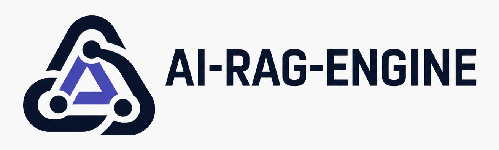
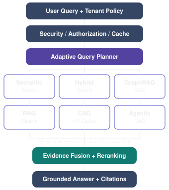
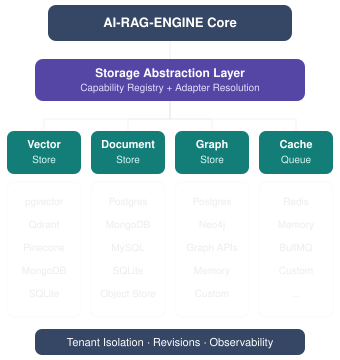

<div align="center">



**TypeScript-/Node.js-Bibliothek für RAG mit austauschbaren LLM- und Vektoradaptern, lokalem semantischem FAQ-/Tool-Routing, Mandantenisolierung und persistenter Dokumentenaufnahme.**

[](https://www.npmjs.com/package/@denizsvnc/ai-rag-engine)
[](https://www.typescriptlang.org/)
[](https://nodejs.org/)
[](https://github.com/Denizsvnc/ai-rag-engine/actions)
[](LICENSE)

---

### 🌐 Dokumentationssprachen

**[English](README.md)** • **[Türkçe](README_tr.md)** • **[Deutsch](README_de.md)**

---

</div>

`@denizsvnc/ai-rag-engine@2.2.0` ist offiziell auf npm verfügbar. ESM und Node.js 22.14+ sind erforderlich. In-Memory-Adapter sind nicht dauerhaft. Modellgewichte werden separat geladen. Sicherheitsfilter bieten robuste Abwehrlinien, garantieren jedoch keine vollständige Angriffs- oder PII-Erkennung.

## Anforderungen und Installation

Nur ESM. Node.js **22.14 oder neuer**; die Kompatibilitätsmatrix umfasst Node 22 und 24. TypeScript-Anwender sollten TypeScript 5.8+ mit NodeNext- oder Bundler-Auflösung verwenden.

```sh
npm install @denizsvnc/ai-rag-engine
```

## Schnellstart (Quick Start)

Deterministisches Testbeispiel ohne externe Abhängigkeiten, Modell-Downloads oder Datenbanken:

```js
import { RAGEngine } from '@denizsvnc/ai-rag-engine';

const engine = new RAGEngine({
  smlConfig: { enabled: false },
  cache: { enabled: false },
  inputs: {
    vectorStore: {
      async search(_query, _topK, filter) {
        if (filter?.tenantId !== 'demo') return [];
        return [{ id: 'rueckgabe', content: 'Rückgaben sind innerhalb von 14 Tagen möglich.' }];
      }
    }
  },
  llmProvider: {
    async generate({ systemPrompt }) {
      return { content: systemPrompt.includes('14 Tagen') ? 'Rückgabefrist: 14 Tage.' : 'Unbekannt.' };
    }
  }
});

await engine.init();
const result = await engine.query('Wie lange ist die Rückgabefrist?', {
  tenantId: 'demo', userId: 'demo-user', roles: ['viewer']
});
console.log(result.answer); // Rückgabefrist: 14 Tage.
```

### Produktionsbeispiel (Multi-Tenant mit Gemini, pgvector & Redis)

Produktionsbeispiel mit externem LLM, persistentem PostgreSQL-Vektorspeicher und verteiltem Redis-Cache:

```ts
import {
  RAGEngine,
  GeminiAdapter,
  PostgresVectorAdapter,
  RedisCacheAdapter,
  LocalFaqAdapter
} from '@denizsvnc/ai-rag-engine';

const engine = new RAGEngine({
  // 1. LLM-Provider (Gemini, OpenAI, Ollama oder Custom API)
  llmProvider: new GeminiAdapter(
    process.env.GEMINI_API_KEY,
    'gemini-2.0-flash'
  ),

  // 2. Wissensabruf & semantisches FAQ-Matching
  inputs: {
    vectorStore: new PostgresVectorAdapter({
      connectionString: process.env.DATABASE_URL,
      tableName: 'enterprise_embeddings'
    }),
    faq: new LocalFaqAdapter({
      filePath: './faq.json',
      defaultMatchThreshold: 0.65
    })
  },

  // 3. Verteilter Cache & Sicherheitsfilter
  cache: {
    enabled: true,
    adapter: new RedisCacheAdapter({
      url: process.env.REDIS_URL,
      defaultTtlMs: 3600000 // 1 Stunde
    })
  },
  security: {
    enabled: true,
    blockHighRiskInjections: true,
    pii: {
      enabled: true,
      maskTCKN: true,
      maskCreditCards: true,
      maskEmails: true
    }
  }
});

// Abfrage mit Mandantenisolation und rollenbasierter Zugriffskontrolle (RBAC)
const response = await engine.query('Zusammenfassung des Q3-Audit-Berichts', {
  tenantId: 'tenant-acme',
  userId: 'usr_8472',
  roles: ['compliance_officer']
});

console.log(response.answer);
console.log('Intent:', response.intent);
console.log('Latenz (ms):', response.latencyMs);
console.log('Quellen:', response.sources);
```

---

## Adaptive Intelligenz & Multi-Strategie-Orchestrierung

AI-RAG-ENGINE wählt, routet und fusioniert Ergebnisse dynamisch über 9 verschiedene Abruf- und Reasoning-Strategien (Semantic Search, Hybrid Search, GraphRAG, KAG, Traditional RAG, CAG, Agentic RAG, Knowledge Graph, Semantic Graph) basierend auf Abfragekomplexität und Richtlinien:

<div align="center">
  
</div>

- **Adaptiver Abfrageplaner (Adaptive Query Planner):** Klassifiziert Abfrageabsichten, steuert parallele Ausführungspläne und überwacht Latenz- und Kostenbudgets.
- **Evidenz-Fusions-Engine (Evidence Fusion Engine):** Reciprocal Rank Fusion (RRF), Token-Budget-Kürzung und Widerspruchserkennung.

---

## Datenbankagnostische Speicherarchitektur

Dank der modularen, fähigkeitsgesteuerten Speicherabstraktionsschicht nach dem Schnittstellentrennungs- (ISP) und Abhängigkeitsumkehr-Prinzip (DIP) ist der Kern von konkreten Datenbanktreibern entkoppelt:

<div align="center">
  
</div>

| Bereich | Vertrag | Referenzadapter |
| :--- | :--- | :--- |
| **Vektorspeicher** | `IVectorStore` | `SqliteVectorAdapter` (`node:sqlite`), `PostgresVectorAdapter` (`pgvector`), `MemoryVectorAdapter`, `QdrantVectorAdapter` (REST) |
| **Dokumentenspeicher** | `IDocumentStore` | `SqliteDocumentAdapter`, `MongoDocumentAdapter`, `MySQLDocumentAdapter` |
| **Graphspeicher** | `IGraphStore` | `MemoryGraphAdapter`, `PostgresGraphAdapter`, `Neo4jGraphAdapter` |
| **Ingestion-Ledger** | `IIngestionStore` | `MemoryIngestionStore`, `PostgresIngestionStore` |
| **Blob- / Objektspeicher** | `IBlobStore` | `MemoryBlobStore`, `LocalFsBlobStore` (Pfad-Traversal geschützt) |
| **Cache & Warteschlange** | `ICacheStore` / `IJobQueue` | `RedisCacheAdapter`, `MemoryCacheAdapter`, `BullMQQueue`, `InMemoryQueue` |

Ausführliche Anleitungen unter: [`docs/STORAGE_PROVIDERS.md`](docs/STORAGE_PROVIDERS.md) und [`docs/architecture/storage-abstraction.md`](docs/architecture/storage-abstraction.md).

---

## Dokumentation

- [Konfiguration, Provider, Vektorspeicher und Fehlerbehebung](docs/USAGE_de.md)
- [Versionsverwaltung und Release-Checkliste](docs/RELEASING_de.md)
- [Änderungsprotokoll (Changelog)](CHANGELOG.md)
- [Release-Bereitschaftsbericht](docs/NPM_RELEASE_READINESS_de.md)
