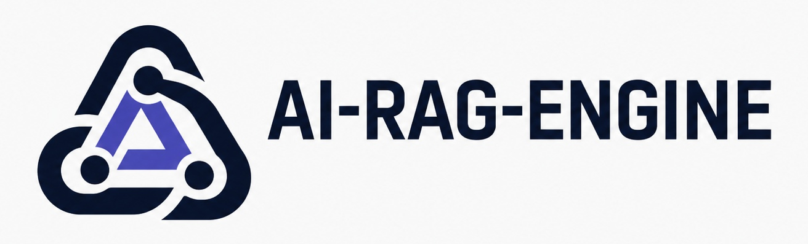
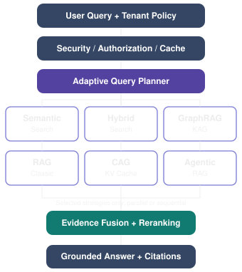
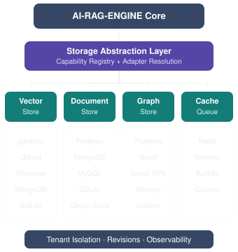

<div align="center">



**Değiştirilebilir LLM ve vektör adaptörleri, yerel semantik FAQ/tool yönlendirme, tenant bağlamı ve dayanıklı doküman alımı sağlayan Node.js/TypeScript RAG kütüphanesi.**

[](https://www.npmjs.com/package/@denizsvnc/ai-rag-engine)
[](https://www.typescriptlang.org/)
[](https://nodejs.org/)
[](https://github.com/Denizsvnc/ai-rag-engine/actions)
[](LICENSE)

---

### 🌐 Dokümantasyon Dilleri

**[English](README.md)** • **[Türkçe](README_tr.md)** • **[Deutsch](README_de.md)**

---

</div>

`@denizsvnc/ai-rag-engine@2.4.1` resmi olarak npm üzerinde yayımlanmıştır. ESM ve Node.js 22.14+ gereklidir. Bellek adaptörleri yeniden başlatmada veriyi korumaz. Model ağırlıkları pakete dahil değildir; embedding kullanımı ilk çalıştırmada yerel cache yoksa indirme gerektirebilir. Güvenlik filtreleri savunma katmanıdır; her türlü saldırının veya kişisel verinin %100 tespitini matematiksel olarak garanti etmez.

## Gereksinimler ve Kurulum

ESM zorunludur. Node.js **22.14 veya üzeri**; uyumluluk matrisi Node 22 ve 24'ü kapsar. TypeScript kullanıcıları NodeNext veya Bundler çözünürlüğü ile TypeScript 5.8+ kullanmalıdır.

```sh
npm install @denizsvnc/ai-rag-engine
```

## Hızlı Başlangıç (Quick Start)

Dış bağımlılık, model indirme veya veritabanı gerektirmeyen deterministik test örneği:

```js
import { RAGEngine } from '@denizsvnc/ai-rag-engine';

const engine = new RAGEngine({
  smlConfig: { enabled: false },
  cache: { enabled: false },
  inputs: {
    vectorStore: {
      async search(_query, _topK, filter) {
        if (filter?.tenantId !== 'demo') return [];
        return [{ id: 'iade', content: 'İadeler 14 gün içinde kabul edilir.' }];
      }
    }
  },
  llmProvider: {
    async generate({ systemPrompt }) {
      return { content: systemPrompt.includes('14 gün') ? 'İade süresi: 14 gündür.' : 'Bilinmiyor.' };
    }
  }
});

await engine.init();
const result = await engine.query('İade süresi kaç gündür?', {
  tenantId: 'demo', userId: 'demo-user', roles: ['viewer']
});
console.log(result.answer); // İade süresi: 14 gündür.
```

### Kurumsal Üretim Örneği (Gemini, pgvector & Redis)

Harici LLM, kalıcı PostgreSQL vektör deposu ve dağıtık Redis önbelleği ile üretim örneği:

```ts
import {
  RAGEngine,
  GeminiAdapter,
  PostgresVectorAdapter,
  RedisCacheAdapter,
  LocalFaqAdapter
} from '@denizsvnc/ai-rag-engine';

const engine = new RAGEngine({
  // 1. LLM Sağlayıcısı (Gemini, OpenAI, Ollama veya Özel API)
  llmProvider: new GeminiAdapter({
    apiKey: process.env.GEMINI_API_KEY,
    model: 'gemini-3.6-flash'
  }),

  // 2. Bilgi Getirimi & Semantik FAQ Eşleme
  inputs: {
    vectorStore: new PostgresVectorAdapter({
      connectionString: process.env.DATABASE_URL,
      tableName: 'enterprise_embeddings'
    }),
    faq: new LocalFaqAdapter({
      filePath: './faq.json',
      defaultMatchThreshold: 0.65
    })
  },

  // 3. Dağıtık Önbellek & Güvenlik Duvarı
  cache: {
    enabled: true,
    adapter: new RedisCacheAdapter({
      url: process.env.REDIS_URL,
      defaultTtlMs: 3600000 // 1 saat
    })
  },
  security: {
    enabled: true,
    blockHighRiskInjections: true,
    pii: {
      enabled: true,
      maskTCKN: true,
      maskCreditCards: true,
      maskEmails: true
    }
  }
});

// Kiracı izolasyonu ve RBAC yetkileriyle sorgulama
const response = await engine.query('3. çeyrek denetim raporu özeti nedir?', {
  tenantId: 'tenant-acme',
  userId: 'usr_8472',
  roles: ['compliance_officer']
});

console.log(response.answer);
console.log('Intent:', response.intent);
console.log('Latency (ms):', response.latencyMs);
console.log('Kaynaklar:', response.sources);
```

---

## Geliştirici Deneyimi (DX) ve Sıfır Zorunlu `.env` Felsefesi

AI-RAG-ENGINE kütüphanesi kullanıcı projelerinde mutlak esneklik sağlar:
- **`node_modules` İzolasyonu:** Kullanıcı paket koduna girip `.env` aramaz veya düzenlemez.
- **Doğrudan Kod Enjeksiyonu:** Tüm parametreler ve gizli anahtarlar constructor nesnesiyle doğrudan verilebilir.
- **Tip Güvenliği ve IntelliSense:** Tüm parametreler TypeScript tanımları ve TSDoc açıklamalarıyla editörde otomatik tamamlanır.

### Yöntem 1: Kod İçinde Doğrudan Verme (In-Code Injection)

```typescript
import { RAGEngine, GeminiAdapter, PostgresVectorAdapter } from '@denizsvnc/ai-rag-engine';

const engine = new RAGEngine({
  llmProvider: new GeminiAdapter({
    apiKey: myVault.get('GEMINI_KEY'),
    model: 'gemini-3.6-flash'
  }),
  storage: {
    vectors: new PostgresVectorAdapter({
      connectionString: myVault.get('DB_URL')
    })
  }
});
```

### Yöntem 2: Özel `.env` Dosyası Belirtme (Custom `.env` Path)

```typescript
import dotenv from 'dotenv';
import path from 'node:path';
import { RAGEngine, OpenAIAdapter } from '@denizsvnc/ai-rag-engine';

// Kendi projenizdeki özel dosya yolunu verin
dotenv.config({ path: path.resolve(process.cwd(), 'config/.env.staging') });

const engine = new RAGEngine({
  llmProvider: new OpenAIAdapter({ apiKey: process.env.STAGING_OPENAI_KEY })
});
```

Node.js 20+ paketsiz çalıştırma:
```bash
node --env-file=./config/.env.production dist/index.js
```

---

## Uyarlamalı Zekâ & Çoklu Strateji Orkestrasyonu

AI-RAG-ENGINE, sorgu karmaşıklığına ve sistem politikalarına bağlı olarak 9 farklı getirme ve akıl yürütme stratejisi (Semantic Search, Hybrid Search, GraphRAG, KAG, Traditional RAG, CAG, Agentic RAG, Knowledge Graph, Semantic Graph) arasından dinamik seçim yapar:

<div align="center">
  
</div>

- **Uyarlamalı Sorgu Planlayıcı (Adaptive Query Planner):** Gelen kullanıcı sorgusunun niyetini sınıflandırır, maliyet ve gecikme bütçelerini denetler.
- **Kanıt Füzyon Motoru (Evidence Fusion Engine):** RRF (Reciprocal Rank Fusion), token bütçesi budaması ve çelişki tespitini yönetir.

---

## Veritabanı Bağımsız Depolama Mimarisi

Arayüz Ayrımı (ISP) ve Bağımlılık Tersine Çevrimi (DIP) prensipleriyle tasarlanan modüler depolama katmanı sayesinde motor çekirdeği hiçbir somut veritabanı sürücüsüne sıkı sıkıya bağlı değildir:

<div align="center">
  
</div>

| Katman | Sözleşme | Referans Sağlayıcılar |
| :--- | :--- | :--- |
| **Vektör Deposu** | `IVectorStore` | `SqliteVectorAdapter` (`node:sqlite`), `PostgresVectorAdapter` (`pgvector`), `MemoryVectorAdapter`, `QdrantVectorAdapter` (REST) |
| **Döküman Deposu** | `IDocumentStore` | `SqliteDocumentAdapter`, `MongoDocumentAdapter`, `MySQLDocumentAdapter` |
| **Graf Deposu** | `IGraphStore` | `MemoryGraphAdapter`, `PostgresGraphAdapter`, `Neo4jGraphAdapter` |
| **Ingestion Günlüğü** | `IIngestionStore` | `MemoryIngestionStore`, `PostgresIngestionStore` |
| **Blob / Dosya Deposu** | `IBlobStore` | `MemoryBlobStore`, `LocalFsBlobStore` (Dizin aşma korumalı) |
| **Önbellek & Kuyruk** | `ICacheStore` / `IJobQueue` | `RedisCacheAdapter`, `MemoryCacheAdapter`, `BullMQQueue`, `InMemoryQueue` |

Detaylı kullanım ve mimari için: [`docs/STORAGE_PROVIDERS.md`](docs/STORAGE_PROVIDERS.md) ve [`docs/architecture/storage-abstraction.md`](docs/architecture/storage-abstraction.md).

---

## Dokümantasyon

- [Yapılandırma, Sağlayıcılar, Vektörler ve Sorun Giderme](docs/USAGE_tr.md)
- [Sürüm Yönetimi ve Yayın Kontrol Listesi](docs/RELEASING_tr.md)
- [Değişiklik Günlüğü (Changelog)](CHANGELOG.md)
- [Yayın Hazırlığı ve Kalite Raporu](docs/NPM_RELEASE_READINESS_tr.md)
