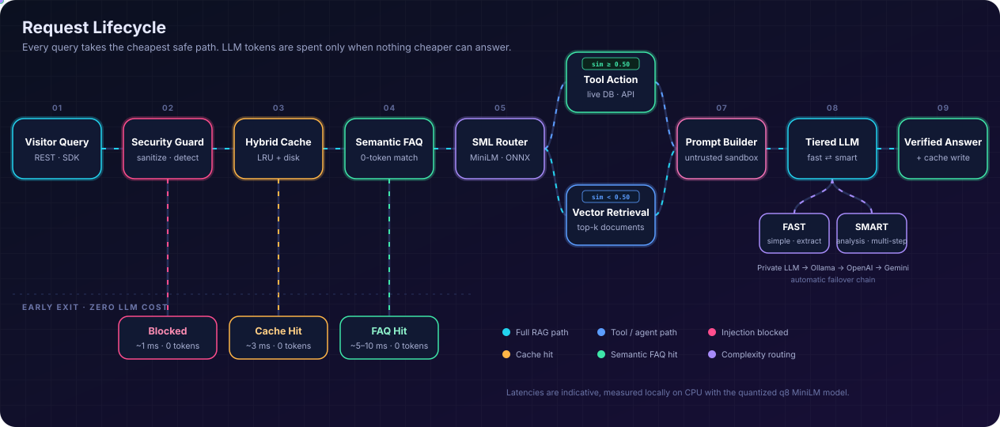
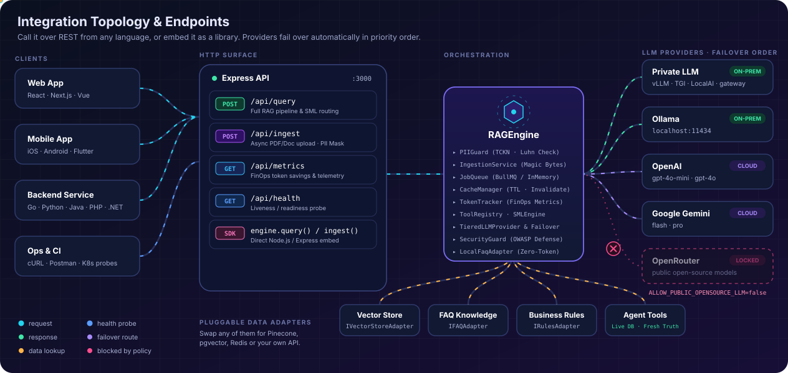
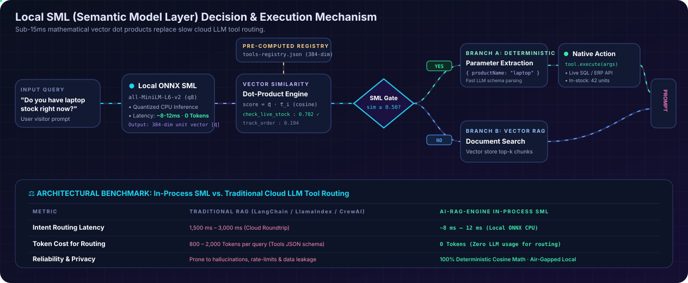

<div align="center">


# ⚡ AI-RAG-ENGINE

**Süreç İçi SML Niyet Yönlendirmesi, Sıfır-Token Anlamsal SSS Önbelleklemesi, Çok Katmanlı LLM Yedeklemesi ve OWASP Prompt Enjeksiyonu Savunmasına Sahip Kurumsal Agentic RAG Mimarisi.**

[](package.json)
[](https://www.typescriptlang.org/)
[](https://nodejs.org/)
[](https://github.com/Denizsvnc/ai-rag-engine/actions)
[](test/)
[](https://github.com/Denizsvnc/ai-rag-engine/stargazers)
[-FF5722?logo=onnx&logoColor=white)](https://huggingface.co/docs/transformers.js)
[](#3-️-owasp-prompt-enjeksiyonu--ziyaretçi-güven-sınırı)
[](#6--sıfır-şişkinlikli-pii-maskeleme-tckn-luhn-ve-veri-egemenliği)
[](LICENSE)

---

### 🌐 Dil / Language / Sprache

**[English](README.md)** • **[Türkçe](README_tr.md)** • **[Deutsch](README_de.md)**

---

</div>

## 📌 Yönetici Özeti (Executive Summary)

Modern kurumsal uygulamalarda kullanıcıdan gelen her ham sorunun doğrudan pahalı, yavaş ve deterministik olmayan bulut LLM'lerine gönderilmesi sürdürülemez maliyetlere, 2-5 saniyelik gecikmelere, veri gizliliği ihlallerine ve prompt injection (komut enjeksiyonu) açıklarına yol açar.

**AI-RAG-ENGINE**, bu darboğazları aşmak için **maliyeti en aza indiren ve güvenlik katmanlarıyla güçlendirilmiş bir şelale (waterfall) mimarisi** sunar:

1. **🛡️ 1 ms OWASP Güvenlik Kalkanı:** Jailbreak, sistem istemi sızdırma ve rol geçersiz kılma girişimlerini herhangi bir LLM çağrılmadan önce anında bertaraf eder.
2. **💾 2 ms LRU & Disk Önbelleği:** Daha önce sorulmuş ve önbelleğe alınmış soruları bellekten veya diskten anında yanıtlar.
3. **🎯 5 ms Sıfır-Token Anlamsal SSS (FAQ):** Farklı kelimelerle ifade edilmiş kullanıcı sorularını yerel 384 boyutlu vektör nokta çarpımı (dot-product) ile eşleştirir (**0 LLM token maliyeti**).
4. **🧠 Süreç İçi Semantik Model Katmanı (SML):** Kuantize edilmiş ONNX modeli (`all-MiniLM-L6-v2`) ile CPU üzerinde harici hiçbir API'ye ihtiyaç duymadan 15 ms altında niyet sınıflandırması ve araç yönlendirmesi yapar.
5. **🔀 Çok Katmanlı LLM ve Otomatik Yedekleme (Failover):** Rutin soruları **Hızlı LLM**'lere (`gpt-4o-mini`, `gemini-1.5-flash`, `llama3.2`), derin akıl yürütme gerektiren soruları ise **Akıllı LLM**'lere (`gpt-4o`, `deepseek-r1`, `gemini-1.5-pro`) yönlendirir; olası kesintilerde sağlayıcılar arasında otomatik geçiş yapar.
6. **🔒 %100 Kurum İçi (On-Premise) Gizlilik Modu:** **Ollama**, **vLLM**, **TGI** ve şirket içi özel VPC uç noktaları için yerleşik adaptörler sunar; `ALLOW_PUBLIC_OPENSOURCE_LLM=false` ayarı ile şirket verilerinin dışarı sızmasını engeller.

---

## 🏛️ Sistem Mimarisi

### 1. İstek Yaşam Döngüsü (Request Lifecycle Waterfall)
*Gelen her sorgu daima en ucuz ve en güvenli yolu izler. Harici LLM'ler yalnızca yerel katmanların yanıtlayamadığı durumlarda devreye girer.*

<div align="center">



</div>

---

### 2. Entegrasyon Topolojisi ve Uç Noktalar (Integration Topology)
*REST uç noktaları ile bağımsız bir mikroservis olarak çalıştırabilir veya Node.js / Express projelerinize doğrudan bir kütüphane olarak entegre edebilirsiniz.*

<div align="center">



</div>

---

### 3. Yerel SML Karar ve İş Yürütme Mekanizması (Derinlemesine Bakış)
*AI-RAG-ENGINE'in süreç içi 384 boyutlu ONNX vektör nokta çarpımı ve deterministik eşik kapısı ile pahalı ve yavaş bulut LLM araç yönlendirmesini nasıl ortadan kaldırdığı:*

<div align="center">



</div>

---

### 4. Güvenli Belge Okuma ve PII Koruma Hattı (Ingestion & PII Pipeline)
*Sıfır şişkinlikli magic byte dosya güvenliği, 11 haneli TCKN mod-10 algoritması, Luhn kredi kartı doğrulaması, BullMQ asenkron kuyruğu ve yerel veri egemenliği yönlendirmesi.*

<div align="center">



</div>

---

## ✨ Öne Çıkan Mühendislik Yetenekleri

### 1. 🧠 Süreç İçi Semantik Model Katmanı (SML) ve Deterministik Araç Yönlendirmesi
* **Mimarideki Kritik Sorun:** Geleneksel Agentic çerçeveler (LangChain, CrewAI, AutoGen vb.) kullanıcı sorusunu ve yüzlerce satırlık JSON araç şemasını uzak bulut LLM'ine (GPT-4 / Claude) göndererek *"Hangi aracı çalıştırmalıyım?"* diye sorar. Bu yöntem tek bir araç çalıştırmak için bile **800–2.000 token harcar** ve **1.5–3.0 saniye ağ gecikmesi** yaratır.
* **SML Çözümü:** *Niyet Yönlendirmesi* ile *Metin Üretimini* birbirinden ayırır. `@huggingface/transformers` ile kuantize edilmiş `Xenova/all-MiniLM-L6-v2 (q8)` modelini doğrudan Node.js sürecinde CPU üzerinde çalıştırır (< 15MB RAM, ~8–12ms, 0 Token).
* **Önceden Hesaplanmış Vektör Kaydı:** Tanımlı tüm araçların açıklamaları için 384 boyutlu normalleştirilmiş birim vektörleri ($\vec{t}_i$) önceden hesaplar ve `src/utils/tools-registry.json` dosyasında saklar.
* **Matematiksel Karar Kapısı (Decision Gate):**
  $$\text{Benzerlik Skoru} = \vec{q} \cdot \vec{t}_i = \sum_{k=1}^{384} q_k \cdot t_{ik}$$
  * **Dal A ($\text{Skor} \ge 0.50$): Deterministik Araç Eylemi Tetiklenir**
    * Yüksek güvenle niyet eşleşir (örn. `check_live_stock` skoru `0.78`).
    * Hızlı LLM katmanı yalnızca parametre JSON'ını ayıklar (`{ productName: "laptop" }`).
    * Yerel fonksiyon (`tool.execute(args)`) doğrudan canlı PostgreSQL, ERP veya depo API'sini sorgular.
    * Gerçek zamanlı veriler, halüsinasyon riski olmadan doğrudan bağlama enjekte edilir.
  * **Dal B ($\text{Skor} < 0.50$): Standart Vektör Aramasına Geçiş**
    * Herhangi bir işlem aracı eşleşmediğinde akış kesintisiz olarak doküman/vektör alma aşamasına aktarılır.

### 2. 🎯 Sıfır-Token Anlamsal SSS Motoru (Semantic FAQ)
* **İfade Çeşitliliğine Tolerans:** Farklı şekillerde sorulan soruları (örn. *"iade süresi kaç gün?"* ile *"ürünü ne zamana kadar geri gönderebilirim?"*) semantik olarak kurumsal bilgi tabanı ile eşleştirir.
* **Vektör Nokta Çarpımı:** SIMD dostu hızlı nokta çarpımı (birim vektörlerde kosinüs benzerliği) ve kalibre edilmiş eşik değeri (`>= 0.60`) ile çalışır.
* **Anında Çözüm:** Doğrulanmış kurumsal yanıtları **<10 ms gecikme ve 0 LLM token maliyeti** ile döndürür.

### 3. 🛡️ OWASP Prompt Enjeksiyonu & Ziyaretçi Güven Sınırı
* **Açık Sınırlandırma (Boundary Framing):** Tüm ziyaretçi girdilerini yalıtılmış `<untrusted_visitor_message>` etiketleri arasına alır.
* **Otoriter Güvenlik Talimatları:** LLM'e ziyaretçi metninin denetlenmemiş ham veri olduğunu ve sistem talimatlarını **asla** değiştiremeyeceğini bildiren İngilizce sistem istemleri üretir.
* **Görünmez Unicode ve Kontrol Baytı Temizliği:** Kaçırma saldırılarında sıkça kullanılan sıfır genişlikli karakterleri (`\u200B`, `\uFEFF`, `\u200D`) temizler.
* **Ayırıcı Etiket Nötralizasyonu:** Kullanıcı metnindeki kapanış etiketlerini etkisiz hale getirerek bağlamdan kaçış (context escape) açıklarını engeller.
* **0-Token Sezgisel Engelleyici:** Yüksek riskli saldırı kalıplarını (DAN modları, "ignore previous instructions", developer override denemeleri) LLM'e göndermeden 1 ms içinde engeller.

### 4. 🔀 Çok Katmanlı LLM Sağlayıcısı ve Kurumsal Yedekleme (Failover)
* **Karmaşıklık Tabanlı Yönlendirme:**
  * **Hızlı Katman (Fast Tier)** (`gpt-4o-mini`, `gemini-1.5-flash`, `llama3.2:3b`): Kısa soruları, araç parametresi çıkarımlarını ve genel konuşmaları üstlenir.
  * **Akıllı Katman (Smart Tier)** (`gpt-4o`, `gemini-1.5-pro`, `deepseek-r1:8b`): Çoklu soru içeren, karşılaştırma veya derin analiz gerektiren sorgularda devreye girer.
* **Kademeli Yedekleme (Failover):** Birincil modelde (örn. OpenAI) kota aşımı (`429`) veya ağ hatası oluştuğunda sistem kesintisiz olarak Gemini veya Ollama'ya geçiş yapar.
* **Kurumsal Veri Koruma:** `ALLOW_PUBLIC_OPENSOURCE_LLM=false` ayarı sayesinde şirket verilerinin kontrolsüz açık kaynak yönlendiricilerine sızması önlenir.

### 5. 💾 Çift Katmanlı LRU Önbellek ve Gerçek Zamanlı Veri Tazeliği (Bayat Veriyi Önleme)
* **Kritik Bayat Veri Problemi:** Klasik RAG sistemlerinde bir ürünün fiyatı **1.000 TL (X)** iken **800 TL (B)** olarak güncellendiğinde, eski vektör kayıtları ve uzun ömürlü sorgu önbellekleri kullanıcıya bayat 1.000 TL yanıtını vermeye devam eder.
* **AI-RAG-ENGINE Veri Tazeliği Mimarisi:**
  1. **Dinamik Veriler Vektörleri Baypas Eder (Canlı SML Araçları):** Fiyatlar, anlık stok miktarları ve rezervasyon durumları ASLA statik vektör veritabanlarına gömülmez. Süreç içi SML niyet motoru, fiyat/stok sorularını doğrudan canlı veritabanı aracına (`check_live_price`) yönlendirerek veriyi sorgu anında PostgreSQL/ERP kaynağından çeker.
  2. **Canlı Araç Önbellek Muafiyeti (`cacheToolResults: false`):** Canlı araç eylemlerinin çıktıları varsayılan olarak 24 saatlik önbelleğe kaydedilmez (veya 60 saniyelik mikro-TTL kullanır); böylece katalogdaki değişiklikler kullanıcılara anında yansır.
  3. **Aktif Önbellek Geçersiz Kılma API'si (Cache Invalidation):** Ürün veya politika güncellemelerinde backend sistemleri bellek ve disk önbelleğini anında temizleyebilir:
     ```typescript
     // Bir ürün veya kelimeye ait önbellek kayıtlarını düşürün
     await engine.invalidateCache('laptop');
     // Regex deseniyle fiyat sorgularını temizleyin
     await engine.invalidateCache(/_price$|fiyat/i);
     ```
  4. **Yapılandırılabilir TTL ve Otomatik Zaman Aşımı:** LRU bellek önbelleği `ttlMs` ayarı ile eskiyen kayıtları belirlenen süre sonunda otomatik olarak temizler.

### 6. 🔒 Sıfır-Şişkinlikli PII Maskeleme (TCKN & Luhn) ve Veri Egemenliği
* **KVKK / GDPR Uyumluluk Zorunluluğu:** Kullanıcı sorguları ve sisteme yüklenen PDF/metin belgeleri sıklıkla T.C. Kimlik Numarası (TCKN), Kredi Kartı, IBAN ve iletişim bilgisi barındırır. Geleneksel sistemler ya bunu göz ardı eder (ağır yasal cezalar riski) ya da sunucuyu kilitleyen 500MB'lık devasa Python NLP kütüphaneleri kurar.
* **Sıfır-Şişkinlikli (Zero-Bloat) Algoritmik Çözüm:** Saf TypeScript ile harici hiçbir bağımlılık olmadan, mikrosaniyeler (**4.03 µs**, 245.408 işlem/sn) içinde çalışır:
  1. **Algoritmik 11 Haneli TCKN Mod-10 Doğrulaması:** Resmî devlet kontrol algoritmasını doğrular:
     $$d_{10} = \left(\left(\sum \text{tek} \times 7 - \sum \text{çift}\right) \bmod 10 + 10\right) \bmod 10, \quad d_{11} = \left(\sum_{k=1}^{10} d_k\right) \bmod 10$$
     *Sıfır Yanlış Pozitif (False Positive):* Sipariş numarası veya barkod gibi rastgele 11 haneli sayılara dokunulmaz, yalnızca gerçek TCKN'ler maskelenir (`[TCKN_100*****46]`).
  2. **Kredi Kartı Luhn Algoritması:** Sağdan sola basamakları ikiye katlayarak gerçek banka kartlarını doğrular ve maskeler (`[CARD_****_****_****_5671]`).
  3. **IBAN & İletişim Bilgisi Temizleme:** Türk (`TR..`) ve uluslararası IBAN'ları, e-posta ve telefon numaralarını otomatik sansürler.
* **Katı Veri Egemenliği Yönlendirmesi (Data Sovereignty):**
  * **Genel Bulut LLM'leri (OpenAI, Gemini):** PII verileri **kesinlikle %100 oranında maskelenir**. Hiçbir kimlik verisi şirket ağ sınırından dışarı çıkamaz.
  * **Şirket İçi Yerel LLM'ler (Ollama, Özel VPC):** Şirket hukuki uyumluluk politikası izin veriyorsa (`allowUnmaskedForLocalLLM: true`), şirket içi yerel akıl yürütme için orijinal veri korunabilir.

### 7. ⚡ Asenkron BullMQ & Bellek İçi İş Kuyruğu (Job Queue)
* **Engellemesiz Mimari:** Doküman okuma, PDF akış analizi, metin parçalama (chunking), PII sansürleme ve ONNX vektör hesaplama ağır işlerdir. Bunların senkron HTTP isteğinde yapılması Express sunucusunu kilitler.
* **Çift Motorlu Takılabilir Kuyruk (`IJobQueue`):**
  * **Sıfır-Bağımlılıklı `InMemoryJobQueue`:** Varsayılan olarak etkindir. Eşzamanlı çalışan havuzu ve durum takibi ile Redis gerektirmeden anında çalışır.
  * **Kurumsal `BullMQJobQueue`:** Çok düğümlü Kubernetes ve kurumsal dağıtımlar için Redis destekli, yeniden deneme ve hata toleranslı BullMQ kuyruğu.
* **İki Adımlı REST Akışı:**
  1. `POST /api/ingest`: Dosyanın ilk byte'larını güvenlikten geçirir ve `202 Accepted` ile bir `jobId` döner.
  2. `GET /api/ingest/status/:jobId`: Kuyruktaki işlemin durumunu (`%0 -> %30 -> %70 -> %100`) raporlar.
* **Çalıştırılabilir Dosya (Magic Byte) Güvenliği:** Yüklenen dosyaların uzantısı `.pdf` veya `.txt` yapılsa bile ikili başlıkları taranarak zararlı dosyalar (`MZ` Windows PE, `\x7fELF` Linux, `#!` Shebang, `0xCAFEBABE`, `.exe`, `.sh`, `.bin`, `.docm`) **1.26 µs** içinde derhal reddedilir.

### 8. 📊 FinOps Telemetrisi ve Canlı Token Maliyet Takibi
* **Yönetici ve Finans Görünürlüğü:** Sistem yöneticileri önbellek ve SML yönlendirmesinin kaç token ve kaç dolar tasarruf sağladığını anlık olarak izler.
* **Her Yanıtta Detaylı Metrikler:** Her `engine.query()` yanıtı gerçek zamanlı maliyet ve token tasarrufunu döndürür:
  ```json
  {
    "answer": "14 gün içinde koşulsuz iade edebilirsiniz.",
    "intent": "FAQ",
    "resolvedBy": "SEMANTIC_FAQ",
    "metrics": {
      "tokensConsumed": 0,
      "tokensSaved": 450,
      "estimatedCostSavedUsd": 0.00135,
      "latencyMs": 4.2,
      "source": "FAQ"
    }
  }
  ```
* **Kümülatif FinOps Uç Noktası (`GET /api/metrics`):**
  Toplam sorgu adedi, sıfır-token çözüm oranı (örn. `%78.4`), tüketilen ve tasarruf edilen toplam token, dolar bazında maliyet kazancı ve p95 gecikmelerini listeler.

---

## 🚀 Hızlı Başlangıç

### Gereksinimler
* **Node.js** >= 20.0.0
* **npm** >= 10.0.0

### 1. Kurulum
```bash
# Depoyu klonlayın
git clone https://github.com/Denizsvnc/ai-rag-engine.git
cd ai-rag-engine

# Bağımlılıkları yükleyin
npm install
```

### 2. Ortam Değişkenlerini Yapılandırın
`.env.example` dosyasını `.env` olarak kopyalayın:
```bash
cp .env.example .env
```

#### Senaryo A: Yerel & Özel Kurulum (Ollama / vLLM / Şirket İçi Sunucu)
*Şirket verileriniz yerel ağınızın dışına asla çıkmaz.*
```env
ALLOW_PUBLIC_OPENSOURCE_LLM=false

# Yerel Ollama
OLLAMA_HOST=http://localhost:11434
OLLAMA_MODEL_FAST=llama3.2:3b
OLLAMA_MODEL_SMART=deepseek-r1:8b

# Veya şirket içi OpenAI-uyumlu VPC uç noktası (vLLM, TGI, LocalAI)
CUSTOM_LLM_URL=http://internal-llm-service.corp.local:8000/v1/chat/completions
CUSTOM_LLM_MODEL=meta-llama/Llama-3.2-3B-Instruct
```

#### Senaryo B: Bulut Sağlayıcılar (OpenAI & Google Gemini)
```env
OPENAI_API_KEY=sk-proj-...
OPENAI_MODEL_FAST=gpt-4o-mini
OPENAI_MODEL_SMART=gpt-4o

GEMINI_API_KEY=AIzaSy...
GEMINI_MODEL=gemini-1.5-flash
```

### 3. Geliştirme Sunucusunu Başlatın
```bash
npm run dev
```
Sunucu yerel ONNX embedding modelini yükler ve `http://localhost:3000` adresinde dinlemeye başlar.

### 4. 🐳 Docker & Konteyner Dağıtımı

#### Docker Compose ile Tek Komutta Başlatma
`ai-rag-engine` ve BullMQ kuyrukları için Redis servisini birlikte ayağa kaldırır:
```bash
docker compose up -d
```

#### Bağımsız Konteyner Olarak Derleme ve Çalıştırma
```bash
# Üretim imajını derleyin
docker build -t ai-rag-engine .

# Ortam değişkenleriyle konteyneri başlatın
docker run -d \
  --name ai-rag-engine \
  -p 3000:3000 \
  --env-file .env \
  ai-rag-engine
```

Konteyner durumunu ve sağlık kontrolünü doğrulayın:
```bash
docker logs -f ai-rag-engine
curl http://localhost:3000/api/health
```

---

## 💻 Kullanım ve Kod Örnekleri

### Örnek 1: Express Middleware Olarak Kullanım
Projelerinize sadece birkaç satır kod ile entegre edebilirsiniz:

```typescript
import express from 'express';
import {
    RAGEngine,
    createRagMiddleware,
    TieredLLMProvider,
    LocalFaqAdapter,
    StaticRulesAdapter
} from 'ai-rag-engine';

const app = express();
app.use(express.json());

// RAGEngine motorunu başlatın
const engine = new RAGEngine({
    llmProvider: TieredLLMProvider.createFromEnv(),
    inputs: {
        rules: new StaticRulesAdapter([
            'Tüm elektronik ürünlerde iade süresi 14 gündür.',
            'Daima kurumsal, nazik ve çözüm odaklı bir üslup kullanın.'
        ]),
        faq: new LocalFaqAdapter({
            filePath: './src/utils/faq-embeddings.json',
            defaultMatchThreshold: 0.60
        })
    },
    security: {
        enabled: true,
        blockHighRiskInjections: true
    },
    cache: {
        enabled: true,
        filePath: './src/utils/query-cache.json'
    }
});

// Endpoint'i Express'e bağlayın
app.post('/api/chat', createRagMiddleware(engine));
 
const PORT = process.env.PORT || 3000;
app.listen(PORT, () => {
    console.log(`⚡ AI-RAG-ENGINE http://localhost:${PORT}/api/chat üzerinde aktif`);
});
```

---

### Örnek 2: Özel Araçlar (Tools) ile Doğrudan Kod İçinden Kullanım

```typescript
import { RAGEngine, TieredLLMProvider } from 'ai-rag-engine';

const engine = new RAGEngine({
    llmProvider: TieredLLMProvider.createFromEnv()
});

await engine.init();

// Canlı veritabanı sorgulayan özel bir araç kaydedin
engine.registerTool({
    name: 'check_live_stock',
    description: 'Bir ürünün canlı depo stok miktarını sorgular',
    parameters: {
        type: 'object',
        properties: {
            productName: { type: 'string', description: 'Ürün adı veya kodu' }
        },
        required: ['productName']
    },
    execute: async (args) => {
        return { inStock: true, unitsAvailable: 42, warehouseLocation: 'Istanbul-Depo-1' };
    }
});

// Soruyu işleyin
const result = await engine.process('Şu an depoda laptop var mı?');
console.log(result.answer);
console.log(`Çözümleyen Katman: ${result.resolvedBy} (Gecikme: ${result.latencyMs}ms)`);
```

---

## 📡 REST API Referansı

### 1. `POST /api/query`
Kullanıcı sorusunu tüm RAG güvenlik ve çözümleme basamaklarından geçirir.

#### İstek Başlıkları
| Başlık | Değer | Açıklama |
| :--- | :--- | :--- |
| `Content-Type` | `application/json` | Zorunlu |

#### İstek Gövdesi
```json
{
  "query": "Kutusu açılmış ürünlerde iade politikanız nedir?",
  "context": {
    "userId": "usr_9876",
    "region": "TR"
  }
}
```

#### Başarılı Yanıt: Sıfır-Token Anlamsal SSS Eşleşmesi (`200 OK`)
```json
{
  "answer": "Satın aldığınız ürünleri, teslimat tarihinden itibaren 14 gün içerisinde orijinal kutusu ve faturasıyla birlikte ücretsiz iade edebilirsiniz.",
  "intent": "FAQ",
  "resolvedBy": "SEMANTIC_FAQ",
  "appliedRules": [],
  "latencyMs": 7
}
```

#### Güvenlik Engeli Yanıtı: Yüksek Riskli Enjeksiyon Girişimi (`200 OK`)
```json
{
  "answer": "Güvenlik politikası nedeniyle bu talimat işlenemez. Lütfen yalnızca ürün ve hizmetlerimizle ilgili sorularınızı iletin.",
  "intent": "SECURITY_BLOCKED",
  "resolvedBy": "SECURITY_GUARD",
  "appliedRules": [],
  "latencyMs": 1
}
```

---

### 2. `GET /api/health`
Kubernetes ve Docker konteynerleri için sağlık kontrolü uç noktası.

```json
{
  "status": "ok",
  "uptime": 348.12,
  "timestamp": "2026-10-26T02:50:00.000Z"
}
```

---

## 🧪 Testler ve Doğrulama

Tüm katmanlar otomatik bir test paketi ile doğrulanmaktadır:

```bash
# Birim ve entegrasyon testlerini çalıştırın (13 pakette 65 test)
npm test

# Yüksek verimli performans ve duman (smoke) testini çalıştırın
npm run benchmark

# k6 çok kullanıcılı eşzamanlı yük testini çalıştırın
k6 run test/performance/k6-load-test.js

# TypeScript tür kontrolü yapın
npm run typecheck

# Üretim paketini derleyin
npm run build

# Canlı vitrin örneklerini çalıştırın
npm run example:ecommerce
npm run example:minimal
```

### Yüksek Verimli Duman (Smoke) Benchmark Sonuçları
*Apple Silicon M-serisi üzerinde ölçülmüştür (%100 CPU süreç içi işlem, harici GPU gerektirmez):*

| Test Edilen Modül | İterasyon | İşlem Hacmi (Throughput) | Ort. Gecikme | p95 Gecikme | Mimari Rolü |
| :--- | :--- | :--- | :--- | :--- | :--- |
| **`PIIGuard.sanitize`** | 10.000 | **231.009 işlem/sn** | **4.28 µs** | 5.08 µs | Algoritmik TCKN Mod-10 + Luhn Kart Kontrolü |
| **`CacheManager.get`** | 20.000 | **3.714.796 işlem/sn** | **0.22 µs** | 0.33 µs | Bellek İçi Sıcak Yol Önbelleği |
| **`RedisCacheAdapter.get`** | 20.000 | **5.165.789 işlem/sn** | **0.17 µs** | 0.25 µs | Çok Örnekli JSON Serileştirme Yolu |
| **`Dot Product` (384-dim)** | 50.000 | **1.513.658 işlem/sn** | **0.64 µs** | 1.71 µs | all-MiniLM-L6-v2 ONNX SIMD Vektör Çarpımı |
| **`Document Chunking`** | 5.000 | **623.085 işlem/sn** | **1.58 µs** | 2.58 µs | Magic Bytes Dosya Kontrolü & Metin Parçalama |
| **`BM25Index.search` (500 Doküman)** | 2.000 | **16.506 işlem/sn** | **60.56 µs** | 69.96 µs | Seyrek BM25 Anahtar Kelime Araması |
| **`TokenTracker`** | 20.000 | **5.425.200 işlem/sn** | **0.16 µs** | 0.29 µs | Gerçek Zamanlı FinOps Maliyet Telemetrisi |

### Test Paketi Özeti
```text
✔ Integration - Express API Routes (3/3 geçti)
✔ Integration - RAGEngine Full Lifecycle (7/7 geçti)
✔ Integration - Document Ingestion & PII Protection Pipeline (4/4 geçti)
✔ Chaos & Concurrency - Init Mutex & Paralel İstekler (2/2 geçti)
✔ Chaos & Fault Injection - Kaskat Hata & Dayanıklılık (4/4 geçti)
✔ Security - Kapsamlı Pentest & Atlatma Denetimi (5/5 geçti)
✔ Core Engine - CacheManager & Veri Tazeliği (7/7 geçti)
✔ FAQ Layer - LocalFaqAdapter (4/4 geçti)
✔ Merkezi Önbellek - RedisCacheAdapter (3/3 geçti)
✔ SML Engine - Circuit Breaker Deseni & Soğuma (2/2 geçti)
✔ Governed Tool Execution - RBAC, Zod & Mutasyon Onayı (4/4 geçti)
✔ Hybrid Search - BM25 & Reciprocal Rank Fusion (3/3 geçti)
✔ Asynchronous Queue - InMemory & BullMQ (4/4 geçti)
✔ LLM Adapters & Multi-Tier Failover (6/6 geçti)
✔ Math Utilities - Dot Product (4/4 geçti)
✔ Multi-Tenancy & Tenant İzolasyonu (2/2 geçti)
✔ Derin Kurumsal Multi-Tenant İzolasyon & Zehirlenme Koruması (3/3 geçti)
✔ Security Guard - PIIGuard & Veri Egemenliği (6/6 geçti)
✔ RAG Evaluation System & Prometheus Telemetrisi (3/3 geçti)
✔ Security Layer - Prompt Injection & Sınır Çerçeveleme (11/11 geçti)
✔ Streaming Ingestion & Geri Basınç Yönetimi (5/5 geçti)
✔ FinOps Metrics - TokenTracker (5/5 geçti)

Toplam: 24 test paketinde 101 test başarıyla geçti (0 hata, %100 başarı oranı)
```

---

## 📂 Proje Dizin Yapısı

```text
ai-rag-engine/
├── assets/
│   ├── logo.jpg               # Proje görsel kimliği ve logosu
│   ├── pipeline.svg           # 2D animasyonlu istek akış şeması
│   ├── endpoints.svg          # 2D animasyonlu entegrasyon topolojisi
│   ├── sml-mechanism.svg      # 2D animasyonlu SML karar motoru şeması
│   └── ingestion-pii-pipeline.svg # 2D animasyonlu güvenli doküman & PII koruma şeması
├── dist/                      # Derlenmiş üretim ESM paketleri ve tipleri
├── src/
│   ├── adapters/
│   │   ├── cache/             # RedisCacheAdapter (LRU yedekli çok örnekli önbellek)
│   │   ├── faq/               # LocalFaqAdapter
│   │   ├── llm/               # CustomLLM, Ollama, OpenAI, Gemini, OpenRouter, TieredLLM
│   │   ├── rules/             # StaticRuleAdapter
│   │   └── vector/            # MemoryVectorAdapter (Dense + BM25 + RRF)
│   ├── api/                   # Express ara yazılımı ve REST uç noktaları (/query, /ingest, /metrics)
│   ├── core/
│   │   ├── cache-manager.ts   # Çift katmanlı LRU + disk önbelleği (TTL & Invalidation)
│   │   ├── engine.ts          # Ana orkestrasyon motoru ve telemetri
│   │   ├── metrics/           # TokenTracker (FinOps maliyet ve token tasarruf takibi)
│   │   ├── prompt-builder.ts  # Prompt enjeksiyon korumalı bağlam oluşturucu
│   │   ├── queue/             # InMemoryJobQueue, BullMQJobQueue & QueueFactory
│   │   ├── security/          # PIIGuard (TCKN/Luhn), Sanitizer & InjectionDetector
│   │   ├── sml-engine.ts      # Yerel ONNX all-MiniLM-L6-v2 süreç içi boru hattı
│   │   └── tool-registry.ts   # Anlamsal araç ve niyet yönlendiricisi
│   ├── services/
│   │   └── document-ingestion.service.ts # Akış (streaming), magic bytes ve PII sansürleme servisi
│   ├── examples/              # Çalıştırılabilir hazır referans örnekler
│   ├── interfaces/            # TypeScript sözleşmeleri ve arayüzler
│   └── utils/                 # Önceden hesaplanmış 384 boyutlu vektör verileri
├── test/
│   ├── chaos/                 # Eşzamanlılık, mutex ve kaskat hata senaryoları
│   ├── integration/           # Tam yaşam döngüsü, API ve Doküman Yükleme testleri
│   ├── performance/           # Yüksek verimli smoke benchmark ve k6 yük testi
│   ├── security/              # Saldırgan komut enjeksiyonu ve pentest audit testleri
│   ├── unit/                  # Önbellek, Redis, SML, LLM, Matematik, PII ve Derin İzolasyon testleri
│   └── run-all.ts             # Platform bağımsız yerel Node.js test çalıştırıcısı
├── CLAUDE.md                  # Kapsamlı geliştirici ve yapay zeka rehberi
├── LICENSE                    # MIT Lisansı
├── package.json               # Paket tanımı ve sabitlenmiş bağımlılık sürümleri
├── README.md                  # İngilizce Dokümantasyon (Varsayılan)
├── README_tr.md               # Türkçe Dokümantasyon
└── README_de.md               # Almanca Dokümantasyon
```

---

## ⭐ Projeyi Destekleyin ve Yıldız (Star) Verin

Eğer **AI-RAG-ENGINE** projelerinizde binlerce dolarlık bulut LLM token maliyetinden tasarruf etmenizi sağladıysa, kurumsal aramanızı hızlandırdıysa veya yapay zeka boru hattınızı güvenceye aldıysa:

⭐ **Lütfen GitHub üzerinde bu depoya bir Yıldız (Star) verin!** ⭐

Vereceğiniz her yıldız, geliştiricilerin ve kurumların sağlayıcı bağımlılığı (vendor lock-in) olmadan gizlilik odaklı, güvenli ve maliyet tasarruflu yapay zeka sistemleri inşa edebileceğini keşfetmesine yardımcı olur.

<div align="center">

[](https://github.com/Denizsvnc/ai-rag-engine/stargazers)
[](https://github.com/Denizsvnc/ai-rag-engine/network/members)
[](https://github.com/Denizsvnc/ai-rag-engine/issues)

*Bir öneriniz mi var, hata mı buldunuz ya da katkıda bulunmak mı istiyorsunuz? Yeni bir Issue veya Pull Request açmaktan çekinmeyin!*

</div>

---

## 📄 Lisans

Bu proje [MIT Lisansı](LICENSE) kapsamında lisanslanmıştır.
Ticari projelerinizde, açık kaynak girişimlerinizde ve kurumsal sistemlerinizde serbestçe kullanabilirsiniz.
