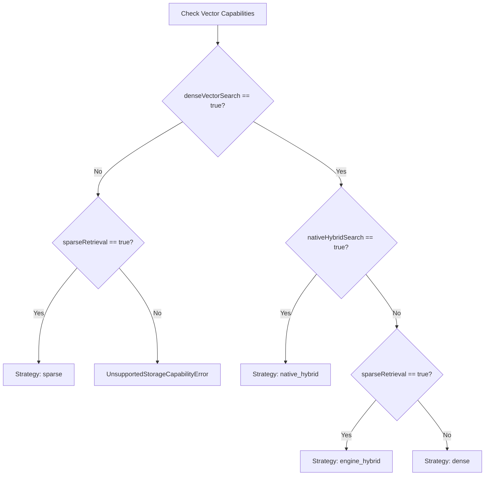

# Storage Adapter Capabilities & Negotiation

## 1. Provider Capability Matrix

The table below documents the verified capabilities of all storage providers implemented in AI-RAG-ENGINE.

| Provider | Role | Dense Vector | Sparse / FTS | Native Hybrid | Metadata Filter | Tenant Isolation | ACID Tx | Atomic Replace | Versioning | Graph Traversal | Native Indexes | Blob Storage |
| :--- | :--- | :---: | :---: | :---: | :---: | :---: | :---: | :---: | :---: | :---: | :---: | :---: |
| **`MemoryVectorAdapter`** | Vector | ✅ | ❌ | ❌ | ✅ | ✅ | ❌ | ✅ | ✅ | ❌ | ❌ | ❌ |
| **`PostgresVectorAdapter`** | Vector | ✅ | ✅ | ✅ | ✅ | ✅ | ✅ | ✅ | ✅ | ❌ | ✅ (HNSW/IVFFlat) | ❌ |
| **`SqliteVectorAdapter`** | Vector | ✅ | ✅ (FTS5) | ✅ (RRF) | ✅ | ✅ | ✅ | ✅ | ✅ | ❌ | ✅ (FTS5/B-Tree) | ❌ |
| **`QdrantVectorAdapter`** | Vector | ✅ | ❌ | ❌ | ✅ | ✅ | ❌ | ❌ | ❌ | ❌ | ✅ (HNSW) | ❌ |
| **`SqliteDocumentAdapter`** | Document | ❌ | ✅ | ❌ | ✅ | ✅ | ✅ | ✅ | ✅ | ❌ | ✅ | ❌ |
| **`MongoDocumentAdapter`** | Document | ❌ | ✅ | ❌ | ✅ | ✅ | ✅ | ✅ | ✅ | ❌ | ✅ | ❌ |
| **`MySQLDocumentAdapter`** | Document | ❌ | ✅ | ❌ | ✅ | ✅ | ✅ | ✅ | ✅ | ❌ | ✅ | ❌ |
| **`MemoryGraphAdapter`** | Graph | ❌ | ❌ | ❌ | ✅ | ✅ | ❌ | ❌ | ❌ | ✅ | ❌ | ❌ |
| **`PostgresGraphAdapter`** | Graph | ❌ | ❌ | ❌ | ✅ | ✅ | ✅ | ❌ | ❌ | ✅ | ✅ | ❌ |
| **`Neo4jGraphAdapter`** | Graph | ❌ | ❌ | ❌ | ✅ | ✅ | ✅ | ❌ | ❌ | ✅ | ✅ | ❌ |
| **`MemoryIngestionStore`** | Ingestion | ❌ | ❌ | ❌ | ✅ | ✅ | ❌ | ❌ | ✅ | ❌ | ❌ | ❌ |
| **`PostgresIngestionStore`** | Ingestion | ❌ | ❌ | ❌ | ✅ | ✅ | ✅ | ❌ | ✅ | ❌ | ✅ | ❌ |
| **`MemoryBlobStore`** | Blob | ❌ | ❌ | ❌ | ❌ | ✅ | ❌ | ❌ | ❌ | ❌ | ❌ | ✅ |
| **`LocalFsBlobStore`** | Blob | ❌ | ❌ | ❌ | ❌ | ✅ | ❌ | ❌ | ❌ | ❌ | ❌ | ✅ |

---

## 2. Capability Definitions

- **`denseVectorSearch`**: Capable of nearest-neighbor semantic search using distance metrics (cosine, inner product, L2).
- **`sparseRetrieval`**: Capable of lexical BM25 or keyword matching against tokenized text.
- **`nativeHybridSearch`**: Capable of executing dense vector and sparse keyword search in a single engine/database pass with combined scoring.
- **`metadataFiltering`**: Evaluates structured metadata predicates (equality, comparison, list membership) alongside search queries.
- **`namespaceIsolation`**: Enforces strict partitioning by `tenantId`, preventing cross-tenant data leakage.
- **`transactions`**: Supports atomic multi-statement operations with commit and rollback semantics.
- **`atomicDocumentReplacement`**: Replaces all chunks belonging to a document ID under a new version atomically without partial reads or orphan chunks.
- **`versioning`**: Tracks monotonically increasing version or revision numbers per document.
- **`graphTraversal`**: Executes multi-hop entity and relationship graph queries (e.g., BFS, Cypher queries).
- **`batchOperations`**: Supports bulk record insertion and updating with high throughput.
- **`nativeIndexes`**: Leverages native hardware or disk acceleration structures (HNSW, IVFFlat, B-Tree, GIN, Inverted Index).
- **`fullTextSearch`**: Supports linguistic or lexical text indexing and ranking.
- **`blobStorage`**: Stores raw unindexed binary payloads (documents, PDF files, image assets).

---

## 3. Dynamic Strategy Negotiation

The `StorageCapabilityRegistry` negotiates the optimal retrieval strategy based on provider capabilities:

```typescript
const registry = new StorageCapabilityRegistry();
registry.register('vectors', sqliteVectorAdapter);

const strategy = registry.negotiateOptimalStrategy();
// Returns: 'native_hybrid' | 'engine_hybrid' | 'dense' | 'sparse'
```

### Negotiation Logic Flowchart



---

## 4. Typed Error Handling

When code attempts an operation unsupported by the active provider, the SDK raises `UnsupportedStorageCapabilityError`:

```typescript
import { UnsupportedStorageCapabilityError } from 'ai-rag-engine';

try {
    registry.assertCapability('vectors', 'nativeHybridSearch');
} catch (error) {
    if (error instanceof UnsupportedStorageCapabilityError) {
        console.error(error.providerName); // "QdrantVectorAdapter"
        console.error(error.capability);   // "nativeHybridSearch"
        console.error(error.message);      // "[StorageCapability] Provider \"QdrantVectorAdapter\" does not support capability \"nativeHybridSearch\"."
    }
}
```

