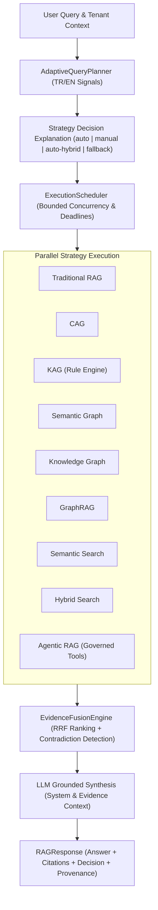

# Adaptive Multi-Strategy Intelligence Architecture

## 1. Overview & Conceptual Model

`@denizsvnc/ai-rag-engine` provides a unified multi-strategy retrieval and reasoning architecture. Rather than treating all intelligence capabilities as identical RAG variations, the system strictly separates:

| Dimension | Capabilities | Responsibility |
|---|---|---|
| **Knowledge Representations** | `Semantic Graph`, `Knowledge Graph` | Relational, ontology, and conceptual networks representing enterprise memory. |
| **Retrieval Mechanisms** | `Semantic Search`, `Sparse (BM25)`, `Hybrid Search`, `Graph Traversal`, `GraphRAG Retrieval` | Fetching raw textual chunks and connected graph entities from storage. |
| **Generation & Reasoning** | `Traditional RAG`, `CAG`, `KAG`, `Agentic RAG` | Synthesis, rule deduction, cache reuse, or autonomous tool execution. |
| **System Orchestration** | `AdaptiveQueryPlanner`, `ExecutionScheduler`, `EvidenceFusionEngine` | Analyzing queries, planning execution paths, bounded concurrency, RRF evidence fusion. |

## 2. Nine Discrete Strategies

1. **Traditional RAG (`traditional_rag`)**: Vector retrieval + LLM synthesis.
2. **Cache-Augmented Generation (`cag`)**: Prompt-prefix and semantic cache lookup; short-circuits LLM when cached context exists.
3. **Knowledge-Augmented Generation (`kag`)**: Formal rule verification and compliance reasoning against active business policies.
4. **Semantic Graph (`semantic_graph`)**: Traversal of conceptual themes and semantic clusters.
5. **Knowledge Graph (`knowledge_graph`)**: Subgraph traversal over factual entities and directional relations.
6. **GraphRAG (`graph_rag`)**: Hybrid retrieval combining dense vector similarity with multi-hop relational path discovery.
7. **Semantic Search (`semantic_search`)**: Pure dense vector similarity ranking with score thresholding.
8. **Hybrid Search (`hybrid_search`)**: Reciprocal Rank Fusion of dense embeddings and BM25 sparse keyword indices.
9. **Agentic RAG (`agentic_rag`)**: Governed multi-step tool execution under cryptographic confirmation tickets and RBAC boundaries.

## 3. Backward Compatibility

When `config.adaptive` is omitted or `config.adaptive.enabled = false`, `RAGEngine` executes 100% legacy logic. Zero regressions for existing consumers.

