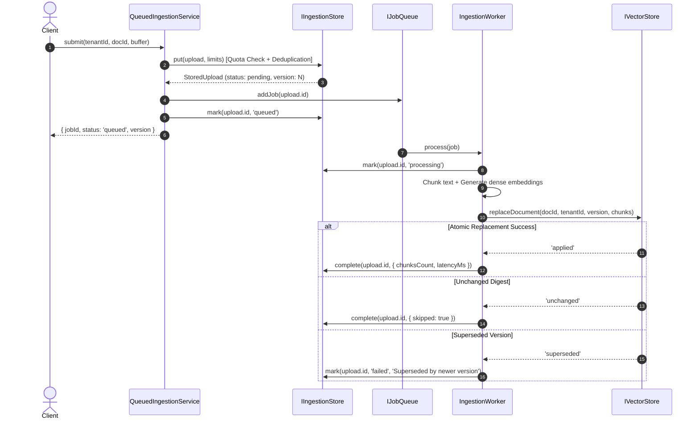

# Distributed Ingestion & Outbox Architecture

## 1. Architectural Overview & Dependency Inversion

Prior versions of AI-RAG-ENGINE coupled the ingestion subsystem directly to PostgreSQL (`PostgresIngestionStore` and `PostgresVectorAdapter`).

The modern ingestion architecture applies **Dependency Inversion**:
- `QueuedIngestionService` depends solely on the abstract `IIngestionStore` contract and `IJobQueue`.
- `IngestionWorker` depends on `IIngestionStore` and `Pick<Required<IVectorStore>, 'replaceDocument'>`.
- Consumers choose between `PostgresIngestionStore` (production durable ledger) and `MemoryIngestionStore` (zero-dependency testing, edge devices, and memory workloads).

```
┌─────────────────────────┐         ┌─────────────────────────┐
│ QueuedIngestionService  │         │     IngestionWorker     │
└────────────┬────────────┘         └────────────┬────────────┘
             │                                   │
             ▼                                   ▼
┌─────────────────────────┐         ┌─────────────────────────┐
│     IIngestionStore     │         │   IVectorStore (Atomic) │
│ (Postgres / In-Memory)  │         │ (Postgres/SQLite/Memory)│
└─────────────────────────┘         └─────────────────────────┘
```

---

## 2. Two-Phase Outbox Pipeline

The ingestion lifecycle follows a durable transactional outbox pattern to guarantee at-least-once processing without data loss during process crashes.



---

## 3. Concurrency Control & Revision Replacement

### Monotonic Versioning
Each document entity maintains an internal monotonically increasing version number (`version: 1, 2, 3...`). Concurrent updates evaluate version order to eliminate race conditions.

### Content-Based Deduplication (SHA-256)
When a document buffer is submitted:
1. The store calculates `digest = sha256(content)`.
2. If the active version of the document matches the incoming digest, the store returns the existing version or marks the replacement as `'unchanged'`, avoiding redundant embedding generation.

### Atomic Vector Replacement (`replaceDocument`)
In traditional vector stores, document updates require separate `DELETE` and `INSERT` steps. If the process crashes mid-execution, orphaned chunks remain or the document disappears from query results.

`IVectorStore.replaceDocument` performs atomic replacement:
1. All new chunks are written within an isolated database transaction or staged version state.
2. Existing chunks with older versions are purged atomically upon commit.
3. If an incoming version is lower than the active version, the call returns `'superseded'` and rolls back immediately, protecting against out-of-order queue deliveries.

---

## 4. Fault Tolerance, Recovery & Quota Enforcement

### Dispatcher Crash Recovery (`dispatchable()`)
If an engine node crashes after writing to `IIngestionStore` but before queue submission, jobs remain in `pending` or `processing` state.
The periodic dispatcher calls:
```typescript
const orphanedJobs = await ingestionStore.dispatchable(50);
for (const job of orphanedJobs) {
    await queue.addJob({ id: job.id, tenantId: job.tenantId });
}
```

### Multi-Tenant Storage Quotas
Before accepting an upload, `IIngestionStore.put()` enforces two hard limits per tenant:
- `maxPending`: Maximum number of uncompleted jobs allowed in the queue.
- `maxStoredBytes`: Maximum cumulative raw bytes stored across all pending buffers.
If exceeded, the store rejects the upload immediately with a descriptive error.

### Retention & Blob Cleanup
Once an upload completes or exceeds the retention window (`retentionDays`), raw binary buffers in the store are set to `null` via `expireFailedBlobs()`, preserving audit metadata while reclaiming database memory and disk space.

