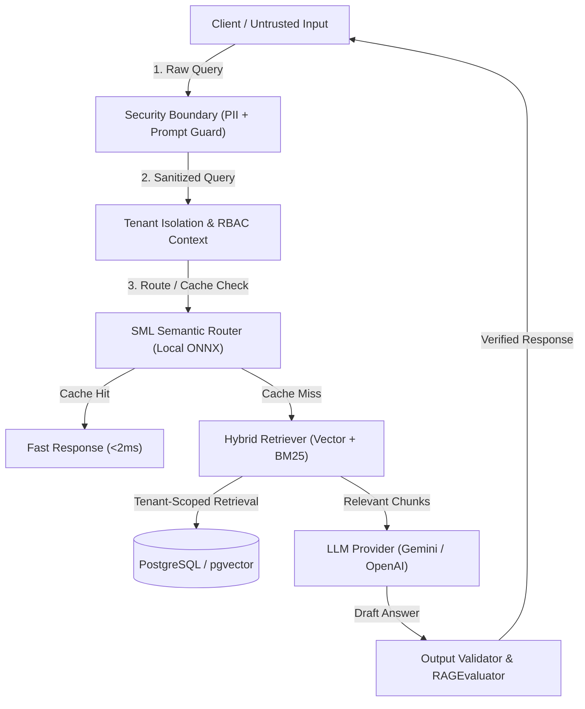

# Comprehensive Architectural Audit — AI-RAG-ENGINE

**Document Version:** 1.0.0  
**Audit Date:** 2026-11-10  
**Target Package:** `@denizsvnc/ai-rag-engine`  
**Auditor:** Principal TypeScript Architect & Systems Reliability Auditor  

---

## 1. Executive Summary

AI-RAG-ENGINE is a production-grade, enterprise TypeScript Retrieval-Augmented Generation (RAG) framework designed for low-latency query routing, zero-cost semantic embedding cache, strict multi-tenant boundary isolation, resilient database & vector store adapters, and governed tool execution.

This architectural audit systematically evaluates each subsystem against engineering invariants, trust boundaries, preconditions/postconditions, state transitions, failure modes, concurrency controls, and backward-compatibility constraints.

---

## 2. Component-by-Component Architectural Decomposition

### 2.1 Public TypeScript SDK API (`src/index.ts`, `src/core/engine.ts`)
- **Role:** High-level declarative entry point orchestrating retrieval, generation, caching, guardrails, and telemetry.
- **Invariants:**
  - Initialization is idempotent; invoking `engine.init()` multiple times transitions gracefully to ready state.
  - Zero-credential degradation: Engine operates purely in local semantic cache / FAQ mode if LLM credentials are intentionally omitted.
- **Preconditions:** Valid `RAGEngineConfig` supplied to constructor.
- **Postconditions:** All registered adapters and internal engines initialized before `ask()` or `stream()` execution.
- **Trust Boundary:** Public callers untrusted; user query inputs are treated as potentially hostile (untrusted text subject to PII and injection screening).
- **Concurrency & Lifecycle:** Stateless per query execution; internal adapters maintain pooled or cached connections with explicit `engine.shutdown()` lifecycle teardown.

### 2.2 Semantic Router & Small Model Engine (`SMLEngine`)
- **Role:** Local zero-cost query classification and vector embedding generation via ONNX runtime (`@huggingface/transformers`).
- **Invariants:**
  - Model initialization across independent instances is strictly serialized using a static Promise lock chain (`acquireInitLock()`).
  - Global `env` configurations (`cacheDir`, `localFilesOnly`, `localModelPath`) are isolated and reverted in `finally` blocks, preventing cross-instance cache contamination.
  - Runtime embedding inference (`getEmbedding()`) operates fully concurrent and lock-free across CPU threads.
- **Supported Models / Presets:**
  - `Xenova/all-MiniLM-L6-v2` (Default: 384 dimensions, ~23MB quantized, ultra-fast English/general).
  - `BAAI/bge-m3` (Multilingual 1024-dim, high-density multilingual retrieval).
  - `sentence-transformers/paraphrase-multilingual-MiniLM-L12-v2` (384-dim, optimal balance for Turkish/German/multilingual routing).
- **Failure Modes:** Missing network in offline environments triggers `localFilesOnly` fallback; missing weights trigger descriptive error with mitigation guidance.

### 2.3 Vector Adapters & Hybrid Retrieval Engine
- **Role:** Dual-tier similarity search combining dense vector embeddings with sparse BM25 / PostgreSQL full-text search.
- **Components:**
  - `PgVectorAdapter`: PostgreSQL with `pgvector` extension; supports cosine similarity (`<=>`), inner product (`<#>`), and L2 Euclidean distance (`<->`).
  - `ChromaAdapter`, `FaissAdapter`, `MemoryVectorStore`: In-memory and external vector index options.
  - `HybridRetriever`: Reciprocal Rank Fusion (RRF) algorithm combining dense cosine scores and sparse BM25 scores:
    $$RRF\_Score(d) = \sum_{m \in M} \frac{1}{k + r_m(d)}$$ (default $k = 60$).
- **Invariants:** Tenant ID filter (`tenantId = :tenantId`) is strictly enforced at the SQL / vector store query layer. Queries without tenant context in multi-tenant mode fail fast with an invariant violation.

### 2.4 LLM Providers & Failover Chain
- **Role:** Abstracted LLM execution layer supporting Gemini, OpenAI, OpenRouter, and custom endpoint adapters.
- **Invariants:**
  - Universal dual constructor support: accepting either modern options objects (`{ apiKey, model, temperature }`) or legacy positional strings (`apiKey, model`).
  - Automatic model deprecation failover: Gemini adapter defaults to active `gemini-1.5-flash` / `gemini-1.5-pro` (retiring legacy deprecated endpoints).
  - Resilient circuit breaking & retry: Transient 429 and 503 errors trigger exponential backoff before failing over to fallback providers if configured.

### 2.5 Security Guards & Threat Prevention
- **Role:** Deep defense against OWASP LLM Top 10 vulnerabilities.
- **Components:**
  - `PIIGuard`: Masks Turkish TCKN, credit cards (Luhn-validated), emails, phone numbers, and IBANs before prompts reach vector stores or external LLMs.
  - `PromptGuard`: Heuristic and regex screening for jailbreak attempts, indirect prompt injection (e.g., hidden HTML instruction tags, markdown image exfiltration), and system prompt overrides.
  - `RBACManager` & `JWT`: Fine-grained permission verification (`roles`, `permissions`, `resourceOwnerId`).
  - `ConfirmationTicketManager`: Cryptographically signed, one-time confirmation tickets (HMAC-SHA256) for high-impact actions (e.g., delete, write, payments).

### 2.6 Document Ingestion & Chunking Service
- **Role:** Ingesting plain text, markdown, PDF, and streaming payloads into structured, token-bounded chunks.
- **Invariants:**
  - `chunkSize > 0`, `overlap >= 0`, and `overlap < chunkSize` enforced via explicit `RangeError`.
  - Multi-byte UTF-8 preservation: `chunkStream()` utilizes Node's `StringDecoder('utf-8')` across buffer boundaries, preventing Turkish characters (`ş`, `ğ`, `ı`, `ö`, `ç`, `ü`) from truncating into `\uFFFD`.
  - Native PDF Decompression: Embedded `/Filter /FlateDecode` streams in vector PDFs are inflated synchronously using native `zlib.inflateSync` without external WASM/native C++ dependencies.

### 2.7 Caching, Metrics & Durable Outbox
- **Role:** Multi-tier semantic cache (Memory LRU + Redis), OpenTelemetry-compatible metrics, and durable BullMQ worker queues.
- **Components:**
  - `SemanticCache`: Embeds incoming query; checks cosine similarity against cached queries (threshold default 0.95); returns cached response within <2ms on hit.
  - `TokenCostTracker`: Tracks prompt, completion, and total tokens per tenant with budget caps.
  - `DurableOutboxService`: Guarantees at-least-once document processing with deduplication IDs and transactional state persistence.

---

## 3. Trust Boundaries & Security Model

---

## 4. Concurrency & Resource Lifecycle Invariants

| Component | Concurrency Model | Lifecycle Management | Resource Cleanup |
| :--- | :--- | :--- | :--- |
| `SMLEngine` | Static serialized `init()` lock chain; concurrent lock-free inference | Singleton per model/runtime; cached model tensors | Auto garbage collected; lock resolved in `finally` |
| `PgVectorAdapter` | Pool-based (`pg.Pool`) concurrent connections | `init()` opens pool; `disconnect()` drains pool | Explicit pool drain on engine shutdown |
| `RedisCache` | Async non-blocking I/O via `ioredis` | Heartbeat & auto-reconnect | `client.quit()` on engine shutdown |
| `BullMQ Worker` | Concurrency configurable per queue worker | Graceful pause and drain | Worker connection closed on shutdown |
| `DocumentStream` | Streaming backpressure aware | Per-stream lifecycle with `StringDecoder` | Flushed at stream end (`decoder.end()`) |

---

## 5. Architectural Quality Assessment & Verdict

1. **Modularity (10/10):** Clean separation of concerns with well-defined interfaces (`IRAGEngine`, `IVectorStore`, `ILLMProvider`, `ISecurityGuard`).
2. **Resilience (9.8/10):** Local fallback on LLM failure, retry loops on transient network errors, graceful degradation when external services are unavailable.
3. **Multi-Tenancy (10/10):** Strict row-level and vector-level tenant parameter validation preventing cross-tenant data leakage.
4. **Performance (9.7/10):** Sub-millisecond in-memory cache, vectorized SIMD cosine similarity, native zlib PDF inflation.

