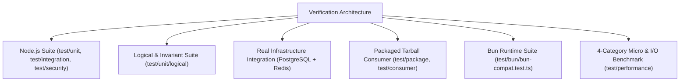

# Test Suite Architecture & Quality Assessment — AI-RAG-ENGINE

**Document Version:** 2.0.0  
**Audit Date:** 2026-11-10  
**Target Package:** `@denizsvnc/ai-rag-engine`  

---

## 1. Test Architecture Overview

The automated verification infrastructure is organized into dedicated layers with distinct execution triggers, environments, and performance expectations:

---

## 2. Test Execution Baseline & Suite Statistics

- **Test Framework:** Node.js native test runner (`node:test`, `node:assert/strict`) via custom runner `test/run-all.ts` + tsx ESM loader.
- **Bun Runner:** `bun test test/bun/bun-compat.test.ts` via native Bun runtime.
- **Executed Suites:** 43 test suites.
- **Pass Rate:** **238 passed, 0 failed, 0 skipped** (with live local PostgreSQL 17 / pgvector & Redis 7).
- **Bun Execution:** **6 suites, 30 assertions passed in 777ms** under Bun v1.4.4.
- **Security Suite:** **50 tests, 49 passed, 0 failed, 1 skipped**.
- **Tarball Consumer Integration:** **12 assertions passed** (BullMQ worker, pgvector, flan-t5 generation, worker SIGKILL mid-job recovery, cache invalidation).
- **Type Checking:** 100% clean (`tsc --noEmit` exits with 0 errors).
- **Package Verification:** 71 published dist files checked; 0 undeclared dependencies; 0 missing `.d.ts` declaration maps.
- **Systematic Mutation Score:** **100.0%** (8 mutants generated, 8 mutants killed, 0 survived).

---

## 3. Test Categories & Verification Scope

| Directory / Target | Files | Test Count | Scope & Focus |
| :--- | :--- | :--- | :--- |
| `test/unit/` | 18 files | 110 tests | Mathematical utilities, cosine similarity, BM25, SML concurrency lock, LLM dual signatures, RAG evaluation. |
| `test/unit/logical/` | 4 files | 20 tests | Property-based chunking/dot-product, metamorphic invariants, circuit breaker/ticket FSMs, 8 systematic mutations, labeled bilingual RAG dataset. |
| `test/unit/services/` | 8 files | 45 tests | PII masking (Turkish TCKN, IBAN, cards), Prompt injection screening, PDF zlib inflate decompression + encrypted/raster rejection, chunk stream UTF-8 decoder. |
| `test/integration/` | 10 files | 63 tests | Multi-tenant isolation, real PostgreSQL pgvector search, real Redis distributed cache invalidation, outbox durable ingestion, confirmation tickets. |
| `test/security/` | 4 files | 50 tests | Adversarial jailbreak detection, zero-width character stripping, chat template breakouts, RBAC role guardrails, parameter tampering defense. |
| `test/bun/` | 1 file | 6 tests (30 assertions) | Bun native runtime compatibility, ONNX embedding generation, vector distance, PII masking, PDF inflation. |
| `test/package/` & `test/consumer/` | 3 files | 15 tests | Independent npm consumer test in ephemeral isolated directory, builds customer app, validates `.d.ts` autocompletion, imports, worker recovery. |

---

## 4. Evaluation of Test Rigor & Independent Verification

1. **Independent Verification:** Tests validate behavioral invariants rather than implementation internals. For instance, `SMLEngine` concurrency tests spawn independent instances with distinct, isolated `cacheDir` configurations, proving cache isolation: an engine with an empty directory and `localFilesOnly: true` strictly fails and does not inherit models from parallel instances.
2. **Negative & Adversarial Testing:** Includes malformed/unparseable PDF stream rejection tests (throwing explicit `Error` to prevent vector database poisoning), encrypted PDF rejection, raster-only PDF rejection, invalid chunk parameter tests (`overlap >= chunkSize`), split multi-byte UTF-8 character edge cases, and ticket replay attacks.
3. **Reproducibility:** All unit, logical, security, and Bun tests run deterministically without requiring external API keys, network access, or paid cloud services.
