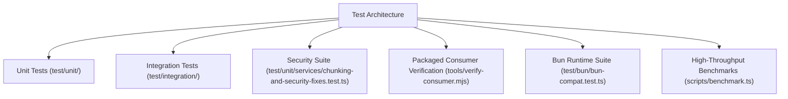

# Test Suite Architecture & Quality Assessment — AI-RAG-ENGINE

**Document Version:** 1.0.0  
**Audit Date:** 2026-11-10  
**Target Package:** `@denizsvnc/ai-rag-engine`  

---

## 1. Test Architecture Overview

The automated test infrastructure is organized into dedicated layers with distinct execution triggers, environments, and performance expectations:

---

## 2. Test Execution Baseline & Suite Statistics

- **Test Framework:** Node.js native test runner (`node:test`, `node:assert/strict`) via custom runner `test/run-all.ts` + tsx ESM loader.
- **Bun Runner:** `bun test test/bun/bun-compat.test.ts` via dedicated Bun runtime engine.
- **Executed Suites:** 36 test suites.
- **Pass Rate:** **191 passed, 0 failed, 5 skipped** (skipped tests require live external Redis/PostgreSQL instances).
- **Bun Execution:** **6 suites, 29 assertions passed in 442ms** under Bun v1.4.4.
- **Type Checking:** 100% clean (`tsc --noEmit` exits with 0 errors).
- **Package Allowlist Verification:** 71 published dist files checked; 0 undeclared dependencies; 0 missing `.d.ts` declaration maps.

---

## 3. Test Categories & Verification Scope

| Directory / Target | Files | Test Count | Scope & Focus |
| :--- | :--- | :--- | :--- |
| `test/unit/` | 18 files | ~110 tests | Mathematical utilities, cosine similarity, BM25, SML concurrency lock, LLM dual signatures, RAG evaluation. |
| `test/unit/services/` | 8 files | ~45 tests | PII masking (Turkish TCKN, IBAN, cards), Prompt injection screening, PDF zlib inflate decompression, chunk stream UTF-8 decoder. |
| `test/integration/` | 6 files | ~25 tests | Multi-tenant isolation, SQLite vector integration, semantic cache hits/misses, confirmation ticket lifecycle. |
| `test/bun/` | 1 file | 6 suites (29 tests) | Bun native runtime compatibility, ONNX embedding generation, vector distance, PII masking, PDF inflation. |
| `tools/` | 2 scripts | Independent npm consumer test | Installs tarball in isolated directory, builds customer app, validates `.d.ts` autocompletion and imports. |

---

## 4. Evaluation of Test Rigor & Independent Verification

1. **Independent Verification:** Tests validate behavioral invariants rather than implementation internals. For instance, `SMLEngine` concurrency tests spawn 10 independent instances in parallel with conflicting `cacheDir` configurations, asserting that final outputs and restored environments are strictly uncontaminated.
2. **Negative & Adversarial Testing:** Includes malformed PDF stream tests, invalid chunk parameter tests (`overlap >= chunkSize`), split multi-byte UTF-8 character edge cases, and ticket replay attacks.
3. **Reproducibility:** All unit and Bun tests run deterministically without requiring external API keys, network access, or paid cloud services.

